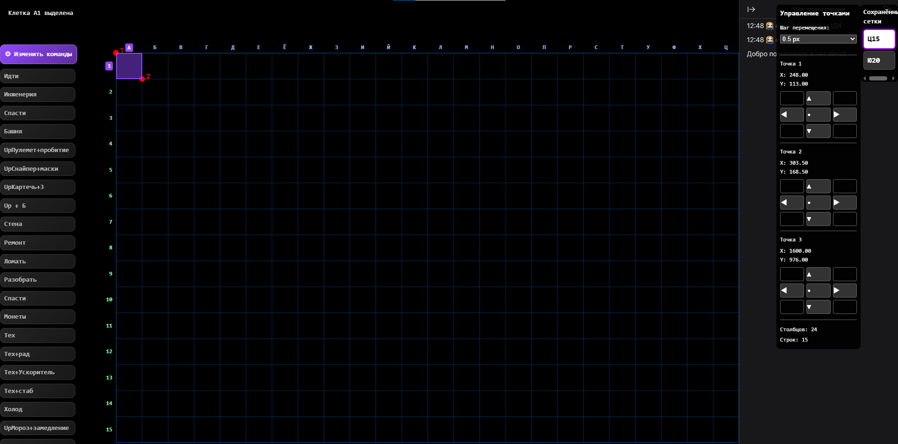

# chatdefgrid


### Build a Grid Using the Browser Console (F12)

An interactive coordinate-grid builder for browser pages, designed for use over the Twitch video player. It overlays a labelled grid on top of the page so you can click any cell to pin its coordinate and send chat messages with that coordinate inserted automatically — or pin a command first and then click cells to fire that command with each clicked coordinate.

The script creates the grid by defining the size of the first cell using points `1` and `2`, then setting the table boundary using point `3`.

---

## Step 1 — Set the Starting Corner

Move the mouse to the **top-left** corner of the first cell and press `1`.

```text
┌──────┐
│  A1  │
└──────┘
```

Point `1` defines the top-left corner of the first cell.

---

## Step 2 — Set the Opposite Corner

Move the mouse to the **bottom-right** corner of the first cell and press `2`.

```text
1──────┐
│  A1  │
└──────2
```

The distance between points `1` and `2` determines the cell width and height.

---

## Step 3 — Define the Table Boundary

Move the mouse to the **bottom-right** corner of the table and press `3`.

Point `3` defines the outer boundary of the grid and can be adjusted later from the control panel.

The script automatically:

* Calculates the number of rows and columns.
* Creates the grid and fills the selected area with cells.
* Assigns coordinates to each cell.
* Saves the grid as an active slot in the **Saved Grids Panel**.

Example:

```text
1──────┐┌──────┐
│  A1  ││  B1  │
└──────2└──────┘
┌──────┐┌──────┐
│  A2  ││  B2  │
└──────┘└──────┘
                      3
```

---

## Grid Coordinates

Columns use letters, rows use numbers.

```text
A1  B1  C1
A2  B2  C2
A3  B3  C3
```

> **Note on letters.** The live overlay renders column letters in Cyrillic (А, Б, В, …). This README uses the Latin equivalents A, B, C, … for readability — the letter in position *n* of the Latin alphabet corresponds to the same position in the Cyrillic one.

### Hover

While the cursor is over the grid, you get immediate visual feedback:

* The cell under the cursor is highlighted.
* The **letter of the column** appears above the cell.
* The **number of the row** appears to the left of the cell.
* The matching letter and number on the rulers are highlighted too.

Hover stays active even in **Transparency Mode** — you always know which cell you are about to click.

Ruler labels are hidden automatically when the cell size drops below `14 px` so the grid does not become unreadable.

---

## Selection & Pinning

The script uses **a single active pin** at any moment. The pin can be either a **command** or a **grid cell**, never both at once, and pins from different categories never coexist.

Pin rules:

| Current state        | Action                      | New state          | Chat message sent?          |
| -------------------- | --------------------------- | ------------------ | --------------------------- |
| Nothing pinned       | Click a command             | Command pinned     | No                          |
| Nothing pinned       | Click a cell                | Cell pinned        | No                          |
| Command pinned       | Click the same command      | Nothing pinned     | No                          |
| Command pinned       | Click a different command   | New command pinned | No                          |
| Command pinned       | Click any grid cell         | Unchanged          | **Yes** (with clicked cell) |
| Cell pinned          | Click the same cell         | Nothing pinned     | No                          |
| Cell pinned          | Click a different cell      | New cell pinned    | No                          |
| Cell pinned          | Click any command           | Unchanged          | **Yes** (with pinned cell)  |
| Anything pinned      | Click on an empty page area | Nothing pinned     | No                          |

Additional rules:

* Commands **without** the `{coord}` placeholder never enter the pin system — every click sends them immediately with no state change.
* Commands **with** `{coord}` are disabled (greyed out) while no grid exists.
* The pinned command is highlighted with a purple border and background; the pinned cell is outlined in purple.
* Pins survive grid rebuilds (moving points): a pinned cell is preserved as long as it still fits inside the new `cols × rows` area; otherwise the pin is cleared and a message is shown in the info panel.
* Pins are reset by `Delete` (clear grid), loading a different saved grid, and entering the commands editor. Clicking on an empty page area also clears the pin (see the table above).
* Pins are not persisted: reloading the page restores the data, but nothing is pinned.

---

## Grid Point Control Panel

After creating the grid, points `1`, `2`, and `3` can be fine-tuned from the control panel.

```text
        ▲
        │
◀────── ● ──────▶
        │
        ▼
```

Available movement steps:

* `1 px`
* `0.5 px`
* `0.1 px`
* `0.01 px`

Point `1` and point `2` define the cell size (width and height).  
Point `3` controls the bottom-right boundary of the table.

Moving point `3` changes:

* number of columns;
* number of rows;
* total grid area.

Point `3` does **not** change the cell size — it only changes the table boundary.

If a move makes the grid invalid (points reversed, cell too small, or grid larger than `200 × 200`), the move is rolled back and an error message is shown in the info panel.

Moving points does **not** reset a pinned cell — the pin is preserved as long as the cell still exists in the new grid.

---

## Commands Panel

Commands are defined **one per line** in the format:

```text
Label !command
```

The **label** is what appears on the button. The **command** is what gets sent to the chat. The two are separated by the **first `!`** in the line.

Example:

```text
Tower !tower {coord}
Frost !frost {coord}
Upgrade !upgrade
```

After clicking **Save**, three buttons appear:

* **Tower** — sends `!tower <coord>`
* **Frost** — sends `!frost <coord>`
* **Upgrade** — sends `!upgrade`

> The text after the first `!` is sent to the chat verbatim. Use whatever syntax your game or chat bot expects — `!tower`, `!build`, `!б`, etc.

### Two-line form

A line that contains no `!` is treated as a label and is joined with the **next** line, which must start with `!`:

```text
Tower
!tower {coord}
```

is equivalent to `Tower !tower {coord}`. This form is supported for convenience, but the one-line form is recommended.

A line without `!` that is **not** followed by a line starting with `!` is reported as a parse error.

Empty lines are ignored.

### Special Characters

* `{coord}` — replaced with the currently pinned cell coordinate when the command fires.

Example — with cell `A1` pinned:

```text
Tower !tower {coord}
```

sends:

```text
!tower A1
```

### Click behavior

Clicking a command button does one of the following (see **Selection & Pinning** above):

* **Command without `{coord}`** — always sends immediately on click.
* **Command with `{coord}`, no grid** — nothing happens; the info panel shows a hint to build a grid first. The button is greyed out.
* **Command with `{coord}`, grid exists, no pin** — the command becomes pinned. Every subsequent cell click sends it.
* **Command with `{coord}`, grid exists, command already pinned** — unpins it.
* **Command with `{coord}`, grid exists, different command pinned** — switches the pin to the clicked command.
* **Command with `{coord}`, grid exists, cell pinned** — sends the command immediately with the pinned cell coordinate. The cell stays pinned.

### Persistence

Commands are saved to `localStorage` under the key `gb-commands`. On the next run:

* If saved commands exist, the button list is rebuilt immediately from storage.
* If no commands are stored, the editor opens with an empty text area.
* If the stored data is corrupted, the script logs a warning and opens the editor with an empty area.

Click **Edit Commands** to return to the editor. Saving new text replaces the stored copy. Any pinned command is cleared when entering the editor.

---

## Saved Grids Panel

The right panel lists every grid that has been created.

* Each saved grid appears as a button labelled with its size, e.g. `J20`.
* The active grid is highlighted with a purple outline on a white background.
* The label updates automatically when point `3` is moved (grid size changes).
* A grid is saved automatically after point `3` is placed on a new setup.
* Press `Shift + S` to save the current grid as an additional slot.
* Press `Delete` to clear the current grid (the slot remains in the list).
* Click a saved grid to load it — grid, points, control panel and coordinate are restored.

### Persistence

Saved grids are stored in `localStorage` under the key `gb-saved-grids`. On the next run:

* All slots from the previous session are shown in the panel.
* The **active** grid is not restored automatically — you must click a slot to load it.

### Deleting a slot

There is no per-slot delete button in the panel. To remove all saved grids at once, use **F2 → Data (localStorage) → Clear**.

---

## Data Storage

The help panel (opened with `F2`) includes a **Data (localStorage)** section that reports the size of each stored key and provides three actions:

| Button | Action |
| ------ | ------ |
| Export | Opens a modal with a pretty-printed JSON dump of all three keys (`gb-layout`, `gb-saved-grids`, `gb-commands`). Click **Copy** to copy it to the clipboard. |
| Import | Opens a modal with an empty text area. Paste the JSON dump into it and click **Import**. The data is written back to `localStorage`; you are asked whether to reload the page to apply it. Invalid JSON is rejected with an error. |
| Clear  | Asks for confirmation, then removes all three keys. The action is irreversible — export first if unsure. |

---

## Video Player

The script hides the Twitch video player automatically when it starts. The grid overlay is shown immediately.

* Press `Shift + 1` to hide the overlay and restore the player.
* Press `Shift + 1` again to show the overlay and hide the player.

The help panel also contains a **▶ Switch to Theatre Mode · alt + t** button that clicks Twitch's own theatre-mode toggle for you.

---

## Panel Size Controls

At the top of the help panel (`F2`) you can adjust the width of the three side panels in pixels:

| Field         | Default | Range    | Controls            |
| ------------- | ------- | -------- | ------------------- |
| Commands      | 165 px  | 40 – 400 | commands panel      |
| Point Control | 180 px  | 60 – 400 | point control panel |
| Saved Grids   | 80 px   | 40 – 400 | saved grids panel   |

* Values apply **immediately** as you type (CSS variables `--gb-col1`, `--gb-col3`, `--gb-col4` on the overlay).
* The centre column (`1fr`) takes whatever space is left.
* Values are stored in `localStorage` under the key `gb-layout` and restored on the next run.
* Press **Reset** to return to the defaults (`165 / 180 / 80`).

---

## Keyboard Shortcuts

| Key              | Action                                                    |
| ---------------- | --------------------------------------------------------- |
| `1`              | Set point 1 — top-left corner of the first cell           |
| `2`              | Set point 2 — bottom-right corner of the first cell       |
| `3`              | Set point 3 — bottom-right table boundary and build grid  |
| `Shift + 1`      | Hide/show the overlay and toggle the video player         |
| `Shift + 3`      | Toggle grid transparency while keeping cell clicks active |
| `Shift + S`      | Save the current grid as a new slot                       |
| `F2`             | Toggle the help panel                                     |
| `Delete`         | Clear the current grid and start setup again              |
| `Shift + Delete` | Unload the script (data in `localStorage` is preserved)   |

Shortcuts are ignored while typing in text fields, text areas and select menus. `F2` works even when a text field has focus.

---

## Transparency Mode

Press `Shift + 3` to toggle the opacity of the grid, point markers and the point control panel.

When transparency mode is enabled:

* Grid lines, column and row labels, and point markers become invisible.
* The point control panel becomes visually invisible and stops accepting input.
* Cell click targets remain active — you can still pin cells.
* **Hover works normally** — the cell under the cursor is highlighted, and the active ruler labels light up.
* A pinned cell's purple outline remains visible.
* The commands panel and saved grids panel are unaffected.

Manual transparency toggle cancels any pending auto-fade timer.

---

## Auto-Fade

After a grid is built or a point is moved, the overlay automatically fades out after a period of inactivity:

* `10 s` — full visibility.
* `5 s` — smooth fade to transparent.

Once faded, the overlay's internal state is updated to "invisible", so a **single** `Shift + 3` restores it. No double-toggle.

Auto-fade timers are started by point moves and grid loads. Manually toggling `Shift + 3` stops any pending timer but does not restart it — the overlay will stay in whichever state you left it in until the next point move or grid load. `Shift + 1` hides the overlay without stopping a running timer.

---

## Help Panel

Press `F2` (or run the script — the help panel opens automatically at start) to display the in-page reference on the right side.

The panel contains:

* build steps,
* hover description,
* point control panel notes,
* command format and examples,
* saved grids notes,
* data storage statistics and controls,
* shortcut table,
* limits,
* panel-size controls,
* a **Switch to Theatre Mode** button,
* a 4 × 4 illustrated example with points `1`, `2`, `3` shown in place.

While the help is open, the small info label in the top-left corner is hidden. Close it with `F2` and the info returns.

The help panel is rendered **above all other layers** (`z-index: 1000003`) and is scrollable.

---

## Limits

* Maximum grid size: `200 × 200` cells.
* Minimum cell size: `1 px` in both directions.
* Cell coordinates use floating-point values; the movement step can be adjusted from the control panel.
* Panel widths: `40 – 400 px` each.

---

## Workflow

1. Open the browser developer console with `F12`.
2. Paste and run the script.
3. Position the mouse and press `1`, `2`, `3` to build the grid.
4. Adjust points `1`, `2`, `3` if necessary.
5. Define commands in the format `Label !command`, one per line (they are stored under `gb-commands`).
6. Click a cell to pin it — then click command buttons to send them with that coordinate.
7. Or click a command to pin it — then click grid cells to send that command with each clicked coordinate.
8. Click an empty page area to clear the pin.
9. Use `Shift + S` to save additional grids during the session.
10. Use the help panel (`F2`) to switch to Theatre Mode, tune panel widths, or export / import / clear the stored data.

---

## Notes

* Keyboard shortcuts are disabled while typing in text fields, text areas, and select menus, except `F2`.
* Point movement controls update the grid automatically.
* Moving point `3` changes the grid size without changing the cell size.
* Panel width settings persist across reloads until you press **Reset** or clear the data via `F2 → Data → Clear`.
* `Shift + Delete` unloads the script from the page. **The script does not delete any `localStorage` data**: panel widths, saved grids, and commands are all preserved and restored on the next run. To clear the data, use `F2 → Data (localStorage) → Clear`.
* Chat messages are sent one at a time with a small random delay between them.
* * The script is designed to run directly in the browser console (or via a userscript manager such as Tampermonkey).
* For Twitch, the chat input field and the send button must be present on the page at the moment a command is sent. If either is missing (for example, while the chat panel is collapsed or still loading), the message will not be delivered.